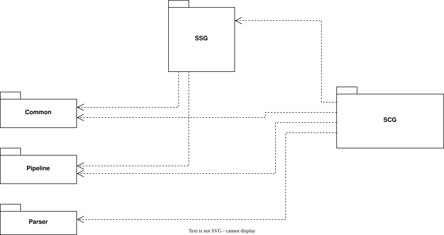
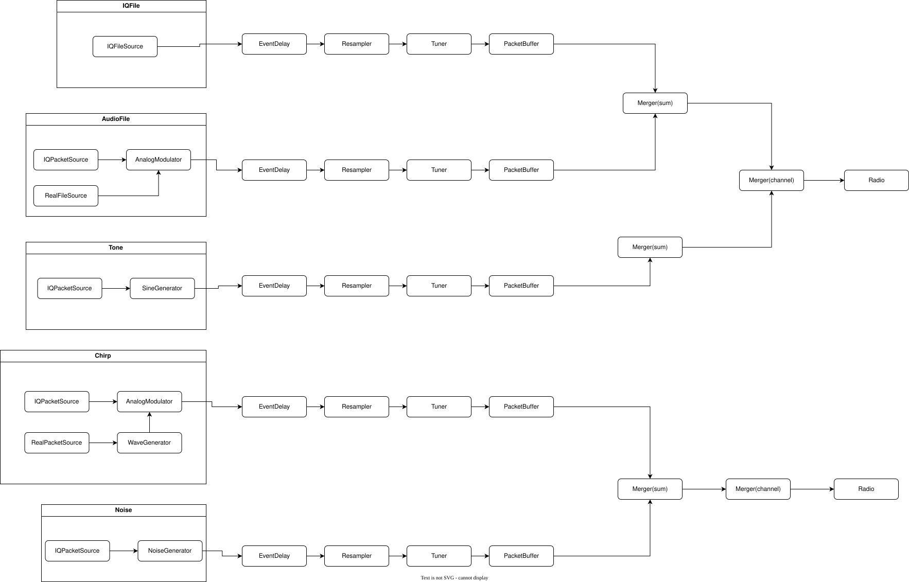

# Scenario Generator

## packages

The SCG package depends on SSG, which is a set of signal processing utilities, and pipeline modules.



## pipeline example

SCG.exe creates a signal processing pipeline based on the scenario descriptor provided as a .json file.
An SCG signal defines a signal source pipeline, which is instantiated for each event that references it.
These pipelines are then merged together into the output channels.




This would be the result of the folowing input (some parameters are missing for simplicity):

```json
{
    "duration": 10,
    "outputs": [
        {
            "name": "r1",
            "nChannels": 2
        },
        {
            "name": "r2",
            "nChannels": 1
        }
    ],
    "signals": [
        {
            "name": "s1",
            "type": "Tone"
        },
        {
            "name": "s2",
            "type": "Chirp"
        },
        {
            "name": "s3",
            "type": "Noise"
        },
        {
            "name": "s4",
            "type": "IQFile"
        },
        {
            "name": "s5",
            "type": "AudioFile"
        }
    ],
    "events": [
        {
            "signal": "s1",
            "output": "r1.0"
        },
        {
            "signal": "s2",
            "output": "r1.0"
        },
        {
            "signal": "s3",
            "output": "r1.1"
        },
        {
            "signal": "s4",
            "output": "r2.0"
        },
        {
            "signal": "s5",
            "output": "r2.0"
        }
    ]
}
```


In this example, there are 5 events, each using a unique signal.
(This is not required. Normally, every event can use any signal and they can overlap in any of the channels.)

The pipeline works as follows:

- Signal generation is done by a unique set of modules for each signal type.
- A series of modules processes the generator's output:
    - EventDelay: handles the timing of the event to make the signal appear only in the specified time window.
    - Resampler: resamples the signal to match the output samplerate.
    - Tuner: tunes the signal to the frequency defined by the event.
    - PacketBuffer: makes the samplecounts in the packets uniform (required for merging).
- Next, the packets will go through 2 sets of Merger modules:
    - The Merger(sum) modules receive multiple input streams, each with a single channel, and sum them.
    - The Merger(channel) modules receive multiple input streams, each with a single channel, and output a single stream, containing all channels.
    - In this example, the first radio has 2 channels, and therefore 2 Merger(sum) modules, and one Merger(channel) module. As a result, the signals from the 1st and 2nd event are summed into channel[0], and the signal from the 3rd event is put into channel[1].
- Finally, the output module receives the packet.
    - In this case, the output is a Radio module, because SCG was run in streaming mode.
    - In recording mode, this would be an IQFileSink module instead.


