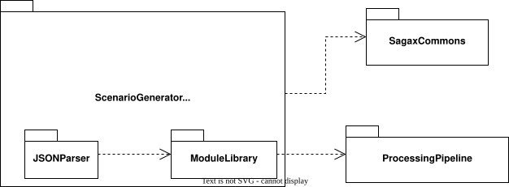
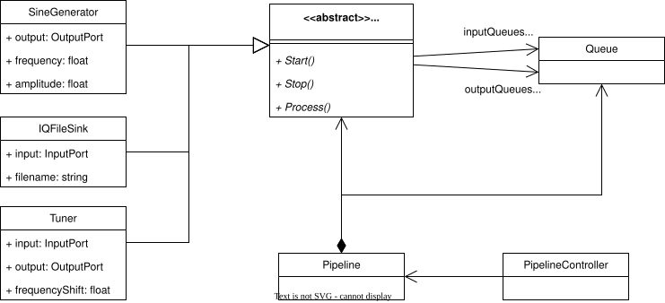
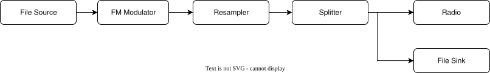
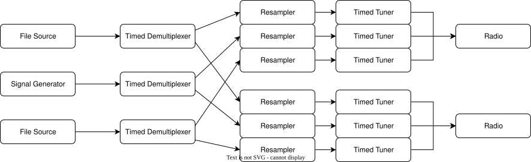
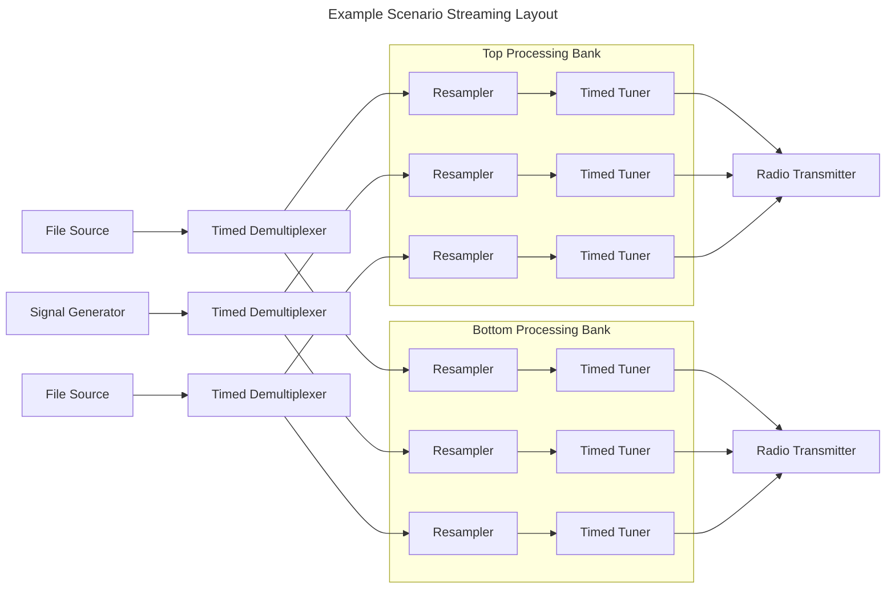
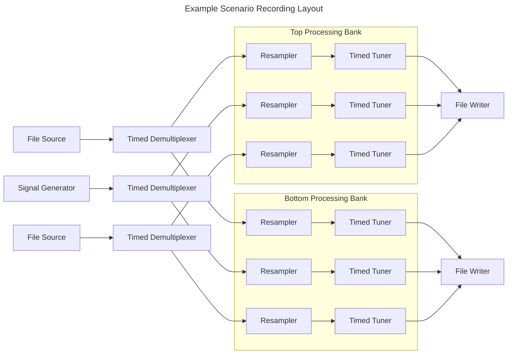
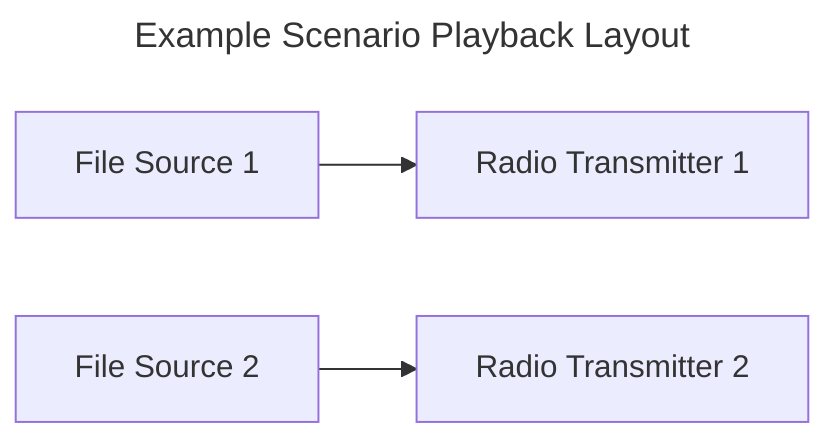
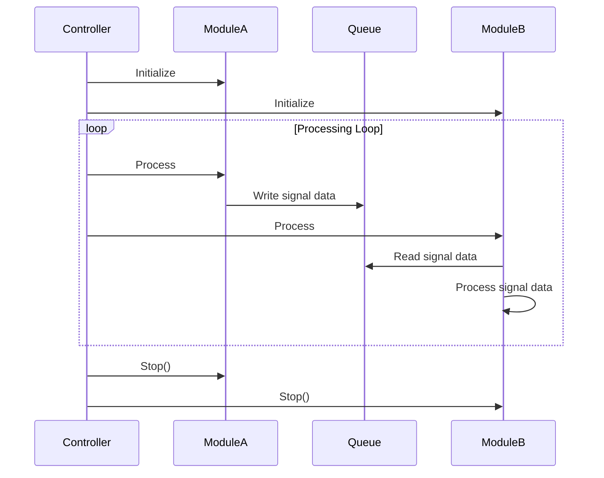

# Scenario Generator
The Scenario Generator is a modular system for constructing and executing signal pipelines that simulate, electromagnetic environments.
It uses a declarative JSON-based configuration to define signal sources, transformations, and outputs.
Each scenario is executed as a real-time pipeline that can operate in one of three modes:
- **Stream Mode**: Real-time signal generation and transmission to device(s).
- **Record Mode**: Capture and save simulated signals to file(s) for later use.
- **Playback Mode**: Reproduce and stream previously recorded scenarios.

# Requirements

## Functional Requirements
- The system must support real-time streaming of IQ data through multiple transmitter devices. 
- Output must be synchronized with internal timing and sampling constraints.
- Must load scenarios from JSON configuration files specifying modules and parameters.  
- Support reading recorded signal data from file sources.
- In record mode, the system must be able to save generated IQ data to defined file formats
- Must include basic signal generators (`Sine`, `Noise`, `FSK`)
- Support chaining multiple modules (`Source`, `Processor`, `Sink`) into an executable pipeline.  
- Provide a runtime controller that handles execution.

## Non-Functional Requirements
- **Performance:** Capable of real-time IQ streaming at system-defined bandwidth.  
- **Extensibility:** New modules and parsers can be registered without modifying existing modules.  
- **Reliability:** Must ensure deterministic execution and graceful failure under load or file I/O errors.  
- **Maintainability:** Code should be modular and readable, separating parsing, pipeline construction, and runtime execution.  
- **Portability:** Must compile and run on Windows and Linux.
- **Usability:** Provide meaningful CLI help and error output for invalid or incomplete input.  

## Design Goals

- **Declarative:** Users define *what* should happen, the system handles *how*.
- **Extensible:** Supports new signal types, events, or output devices.
- **Deterministic:** Scenario execution is reproducible.
- **Real-time capable:** Supports high-throughput streaming without pregenerating the output.
- **Portable:** Runs on Windows and Linux, and is easy to install.

## High level concepts

### Scenario
- Complete description of a simulation scenario.
- Contains:
  - **Outputs** - destinations for signals (radio, file, network)
  - **Signals** - generated or prerecorded baseband transmissions
  - **Events** - time-scheduled activations of signals linked to outputs
- Defines global parameters such as duration and scenario name

### Output
- Represents a logical or physical endpoint for signal delivery.  
- Specifies operational parameters such as frequency, sample rate, and device metadata.  
- Can be shared by multiple signals.

### Signal
- Represents a baseband signal that could be transmitted on an output device.
- Can be sourced from a signal generator or IQ file.
- Generates a sequence of processing modules to create the contents of a signal.  
- Can be transmitted multiple times on different outputs.

### Event
- Scheduled occurence of a signal on a linked output.
- Specifies:
  - Start and end time
  - Transmission frequency
  - Amplitude

### Scenario Generator (package diagram)

## Low level Pipeline Architecture

### Module
- Unit of processing separated for the purpose of modularity and parallelization.
- Modules have:
  - **Input ports** - read data from upstream queues.  
  - **Output ports** - write data to downstream queues.  
  - **Processing routine** - an algorithm to process/transform the incoming data

### Queue
- FIFO buffer connecting modules through ports.  
- Supports thread-safe read/write operations.

### Pipeline
- Graph formed by modules and queues.  
- Managed by a runtime controller that handles scheduling and synchronization.

### Abstract pipeline (class diagram)

### Pipeline instance example (non-UML)

### Scenario pipeline instance example (non-UML)

## Scenario Transformation

- Scenarios are parsed from declarative definitions (JSON).  
- These scenario elements are mapped to executable pipeline components:
  - Module instances are created.  
  - Ports are connected through queues.  
  - Events are scheduled based on time parameters.  
- Based on the Scenario Genrarator mode the executable pipelines are different:

## Execution Flow

1. **Scenario Loading**  
   - Parse scenario configuration.  
   - Validate signals, outputs, and events.

2. **Pipeline Construction**  
   - Instantiate modules for each signal.  
   - Allocate queues for each port connection.  
   - Link modules in a DAG respecting event timing.  

3. **Pipeline Execution**  
   - Initialize modules.  
   - Run processing loop, reading from input ports and writing to output ports.
   - Stop execution if all modules stopped processing.  

